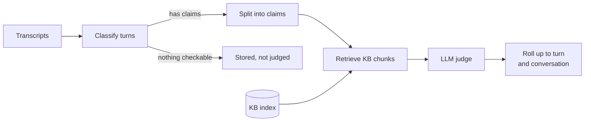
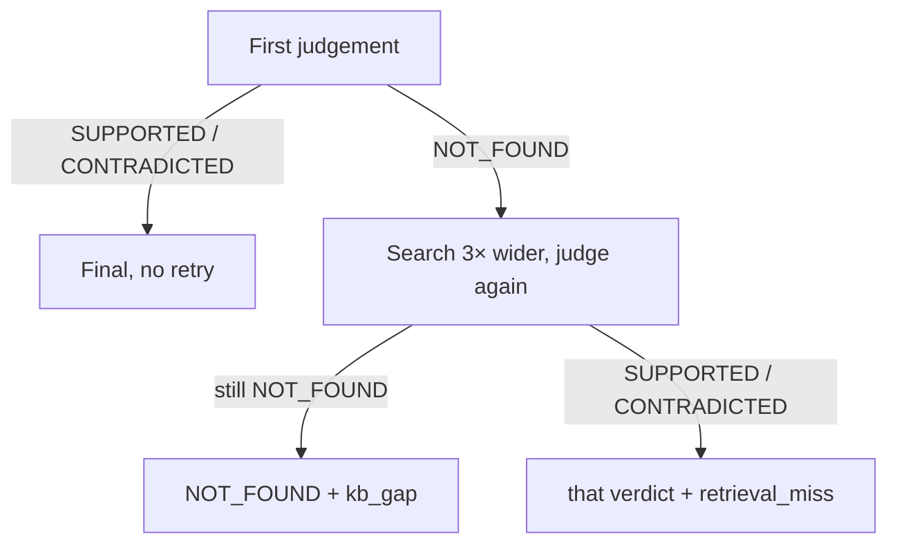

# Ava Evaluator

Checks whether Ava, TTU Online's voice agent, says things backed by TTU's knowledge base (KB).

## Quick start

Needs [Docker Desktop](https://www.docker.com/products/docker-desktop/) running. Works offline with no API key
(stub mode, which is not a real verdict).

```powershell
copy .env.example .env
docker compose up --build      # Postgres + API + frontend

# in a second terminal
docker compose run --rm api python scripts/make_sample_kb.py
docker compose run --rm api python -m ava_eval ingest
docker compose run --rm api python -m ava_eval index-kb
docker compose run --rm api python -m ava_eval evaluate
docker compose run --rm api python -m ava_eval report
```

Frontend: http://127.0.0.1:8080 · API docs: http://127.0.0.1:8000/docs

## LLM-as-judge pipeline



The judge is an LLM (temperature 0) that reads only the retrieved KB excerpts, never its own knowledge. For each
claim it returns a verdict (`SUPPORTED`, `CONTRADICTED` or `NOT_FOUND`), a rationale, and the `chunk_id` of the
excerpt that decided it.

## Asymmetric retry

Only `NOT_FOUND` gets a second chance: one retry with a search 3× wider (`AVA_RETRY_K_MULTIPLIER`).



- Still not found → `kb_gap`: the KB is missing this, so TTU's content team fixes it.
- Found on retry → that verdict plus `retrieval_miss`: the evidence existed but our search missed it.

`SUPPORTED` and `CONTRADICTED` never retry. Retrying a contradiction would let the judge hunt for a friendlier
chunk and bury a real error.

## Evidence-ID check

The `chunk_id` the judge cites must be one of the chunks it was shown. If it's made up, or missing on a
`SUPPORTED`/`CONTRADICTED`, the claim fails and shows as `UNJUDGED`. A flag is never saved without evidence
you can trace back to the KB.

## Running tests

```powershell
docker compose up -d db                       # test database
python -m pytest                              # whole suite, offline
python -m pytest tests/test_judge_policy.py   # retry and evidence-ID check only
cd frontend; node --test                      # frontend logic (Node 18+)
```
