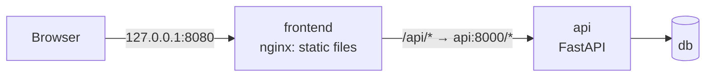

# Frontend and transcript submission

[← Overview](overview.md) · [Operations](operations.md)

**Open:** `http://127.0.0.1:8080` after `docker compose up --build` · **Code:** [`frontend/`](../frontend/), [`ava_eval/evaluation_service.py`](../ava_eval/evaluation_service.py), [`ava_eval/api/main.py`](../ava_eval/api/main.py)

## What it does

A web page for TTU staff. Paste or upload one transcript, and the page runs it through the evaluator and shows each
turn with its claims, verdicts and evidence. It also lists every conversation already in the database, worst first,
so earlier results can be opened again.

The page never decides anything itself. Every verdict, count and rollup comes from the API, which reads the same SQL
views as `report` ([Step 7](steps/s7-aggregate.md)). If the page ever needs to recompute a rollup in JavaScript,
something has gone wrong.

## How it's wired



- [`frontend/Dockerfile`](../frontend/Dockerfile) copies `index.html`, `app.js`, `lib.js` and `styles.css` into
  `nginx:1.27-alpine`. There is no build step and no npm install.
- [`frontend/nginx.conf`](../frontend/nginx.conf) serves those files and forwards anything under `/api/` to the `api`
  service with the `/api` prefix removed (`/api/conversations` → `http://api:8000/conversations`). The page only
  ever calls relative URLs like `/api/health`, so the browser sees one origin and CORS never comes into it.
- `proxy_read_timeout 300s`: nginx waits up to 5 minutes for an evaluation to finish.

## Views and routes

The page is one HTML file with three views. Which one shows is decided by the part of the URL after `#` (hash
routing), parsed by `parseRoute` in [`lib.js`](../frontend/lib.js).

| URL hash | View | API calls |
|---|---|---|
| `#/` (or anything unrecognised) | **Evaluate**: a textarea and file picker for one transcript | `POST /api/evaluations`; `GET /api/health` on load |
| `#/conversations` | **Conversations**: a table of every conversation, worst first, rejected ones last (`orderConversations`) | `GET /api/conversations` |
| `#/conversations/<id>` | **Detail**: summary counts, then every turn with its claims | `GET /api/conversations/{id}` |

- Session ids are URI-encoded in the hash (`detailRoute`), because a fallback id from a rejected submission contains
  `#` (`api-submission.json#0`).
- Right after a successful submit, the page moves to that conversation's detail URL and renders the POST response it
  already has, instead of fetching the same rows again. Reloading or sharing the URL fetches fresh.
- Every navigation bumps a counter. A slow fetch that lands after the user has moved on is dropped rather than
  overwriting the new view.

## Submitting a transcript

The body is the same JSON shape as a transcript file ([Step 1](steps/s1-ingest.md#inputs--outputs)): one conversation
object, not an array.

[`POST /evaluations`](../ava_eval/api/main.py) calls `submit_and_evaluate` in
[`evaluation_service.py`](../ava_eval/evaluation_service.py), which runs, **while the request waits**:

1. `ingest_payload` ([Step 1](steps/s1-ingest.md)): the normal validation rules, saved with
   `source_file = "api-submission.json"`. A rejected transcript is saved as a rejected row, exactly like a bad file.
2. `pipeline.evaluate([session_id])`: steps 3–6 for that one conversation.
3. Reads back `{session_id, summary, turns, claims}` with the same store functions `GET /conversations/{id}` uses.

| Status | Cause | Page shows |
|---|---|---|
| `200` | Evaluated. **May still contain unjudged claims** (see below) | the detail view |
| `422` | Step 1 rejected the transcript (`detail` = `{session_id, error}`), or the body isn't a JSON object (FastAPI's own validation) | "Transcript validation failed" |
| `503` | Evaluation can't start: the KB index is empty, or the database is unreachable (`EvaluationUnavailableError`) | "Evaluator unavailable" |
| `500` | The pipeline errored on this conversation (`EvaluationFailedError`). The detail is a generic message, not the exception text | "Evaluation failed" |
| `504` | nginx stopped waiting after 300s. The API keeps running the pipeline and saves the results | "Evaluation is still running", with a link to Conversations |

## How results are shown

All the display rules live in [`lib.js`](../frontend/lib.js). [`app.js`](../frontend/app.js) only builds the page from
them.

- **`STATES`** gives every verdict and turn label a plain-words label, a colour (`tone`) and a `rank` for sorting:
  CONTRADICTED 5 > NOT_FOUND 4 > UNJUDGED 3 > SUPPORTED 2 > NO_CLAIMS / NOT_EVALUATED / UNCLASSIFIED 1. An unknown
  label shows its raw text in a neutral colour instead of breaking the page.
- **A claim with `verdict: null` is "Not judged"** (`claimState`). Step 6 failed on it, so it has a claims row but no
  verdicts row. The card says to re-run instead of showing empty rationale and evidence rows.
- **A turn is "incomplete" when `unjudged_count > 0`** (`isIncomplete`), even if its `turn_verdict` is `SUPPORTED`.
  The view shows the worst *real* verdict, so `unjudged_count` is the only signal. Such a turn sorts with UNJUDGED
  turns (`turnRank`), not among fully grounded ones.
- **Turns that need review start open** (`needsReview`: CONTRADICTED, NOT_FOUND, UNJUDGED, or incomplete). The rest
  are collapsed. "Worst first" / "Transcript order" and "All turns" / "Needs review" controls re-sort without a fetch.
- **Stale evidence**: when `kb_changed_since_judged` is `true` (`isStale`), the claim warns that the KB was re-indexed
  after it was judged ([Step 7 gotchas](steps/s7-aggregate.md#gotchas)).
- **Tags in plain words** (`tagLabel`): `kb_gap` → "Not in the KB", `retrieval_miss` → "Search missed it".
- **Stub banner**: shown when `GET /health` reports `stub_llm` or `stub_embed` true.
- Error bodies in any FastAPI shape (a string, a validation list, or `{session_id, error}`) become one readable
  message (`errorDetail`).

## Why it's built this way

- **Plain static files, no framework.** Three views and a table don't need a build pipeline, and nginx can serve the
  folder as-is.
- **Logic in `lib.js`, rendering in `app.js`.** `lib.js` never touches the page (the DOM), so Node can test it
  directly without a browser.
- **`textContent` only, never `innerHTML`.** Transcripts and rationales are untrusted text. Inserting them as HTML
  would let a transcript run script in a staff member's browser (XSS). `tests/test_frontend.py` fails if
  `innerHTML`, `outerHTML` or `insertAdjacentHTML` appear.
- **Hash routes.** The server always returns the same `index.html`, so nginx needs no rewrite rules, and a result has
  its own URL that survives a reload.
- **Through nginx, not straight to `:8000`.** One origin means no CORS setup, and the API URL isn't baked into the
  JavaScript.
- **Synchronous submit.** One transcript takes seconds to a minute live, and a background job queue would be a whole
  extra system. The 504 path covers the rare slow case, because the pipeline saves its results either way.

## Gotchas

- **`POST /evaluations` has no authentication, and in live mode every call spends Gemini quota.** Both ports are bound
  to `127.0.0.1` for this reason. Add auth before exposing either one ([Going live](operations.md#going-live)).
- **A `200` doesn't mean every claim was judged.** CLI `evaluate` exits 1 on unjudged claims; the API returns them as
  `verdict: null` rows and the page marks them "Not judged".
- **Resubmitting the same `provider_session_id` replaces that conversation**: turns, claims, and by cascade their
  retrievals and verdicts.
- **The submit view evaluates one conversation per request.** A JSON array (as `ingest` accepts) is rejected by FastAPI
  with `422`.
- `lib.test.js` and `package.json` are deliberately **not** copied into the image; `tests/test_frontend.py` checks that.

## Tests

```powershell
cd frontend
node --test          # needs Node 18+; no npm install, no dependencies
```

- [`frontend/lib.test.js`](../frontend/lib.test.js): unjudged claims and incomplete turns, state fallbacks,
  worst-first and transcript ordering, the review filter, stale flag, tag labels, routes (including an id containing
  `#`, and a malformed escape), conversation ordering, error body parsing.
- [`tests/test_frontend.py`](../tests/test_frontend.py) (pytest): the container files exist, the Dockerfile ships
  `lib.js` but not the tests, nginx proxies `/api/` to `api:8000`, compose has a separate `frontend` service, the page
  has its controls, `app.js` loads as a module importing `lib.js`, only relative API URLs and no unsafe DOM calls,
  and `package.json` has no dependencies.
- [`tests/test_api.py`](../tests/test_api.py): `POST /evaluations` maps each service error to `422` / `503` / `500`,
  the GET routes are unchanged, and a conversation with a failed claim returns exactly the fields the page reads
  (`unjudged_turns`, `unjudged_count`, `verdict: null`).
- [`tests/test_evaluation_service.py`](../tests/test_evaluation_service.py): the full submit returns frontend-ready
  results, a rejected transcript stops before the pipeline, and pipeline and empty-KB errors become the right service
  errors.

## Connects to

- **Step 1:** [`ingest_payload`](steps/s1-ingest.md#how-the-code-works) validates the submission.
- **Steps 3–6:** run through `pipeline.evaluate`, the same code path as the `evaluate` command.
- **Step 7:** every number on the page comes from the [views and API](steps/s7-aggregate.md).
