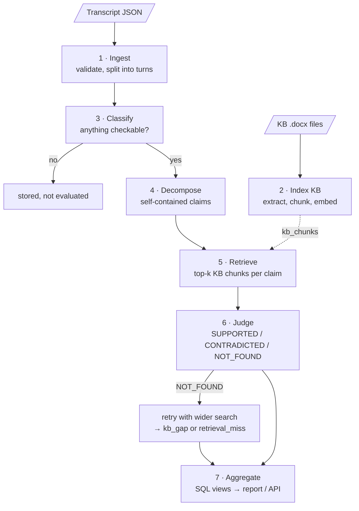
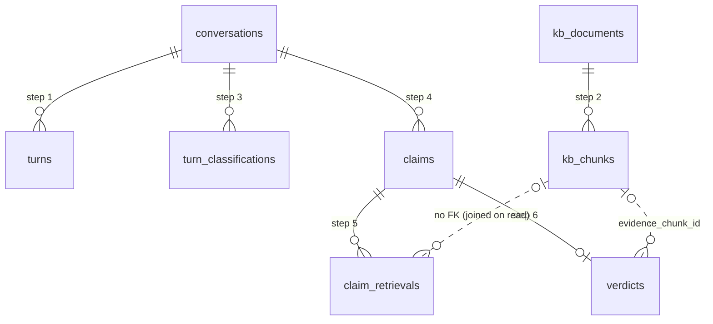

# Ava Evaluator: Overview

Start here. This page is the big picture: what the system is for, how the parts fit together, and where to go for detail.

## Reading order

| # | Doc | Read it to… |
|---|---|---|
| 1 | **Overview** (this page) | understand the problem, the verdicts, and the architecture |
| 2 | [Walkthrough](walkthrough.md) | watch one real conversation go through all 7 steps, with the actual database rows |
| 3 | Step docs: [1 Ingest](steps/s1-ingest.md) · [2 Index KB](steps/s2-index-kb.md) · [3 Classify](steps/s3-classify.md) · [4 Decompose](steps/s4-decompose.md) · [5 Retrieve](steps/s5-retrieve.md) · [6 Judge](steps/s6-judge.md) · [7 Aggregate](steps/s7-aggregate.md) | see how one step works in code, why it's built that way, and what can go wrong |
| 4 | [Operations](operations.md) | run, configure, test, migrate, and work with Docker |

Every step doc uses the same sections: *What it does → Inputs/outputs → How the code works → Stub vs live → Why it's
built this way → Gotchas → Tests → Connects to.*

---

## The problem

**Ava** is TTU Online's voice agent (built on ElevenLabs). Callers ask about programs, GPA requirements, deadlines, and aid.
This project checks, automatically, **whether what Ava says is backed by TTU's own knowledge base (KB)**.

It reads exported call transcripts, splits each of Ava's answers into individual checkable statements, looks each one
up in the KB, and records whether the KB **supports** it, **contradicts** it, or **says nothing about it**.

In Phase 1, **the KB itself is the ground truth**. There's no hand-written answer key. That answers "is Ava faithful to TTU's
documentation?" without anyone having to write a golden dataset first. Checking whether the documentation is itself
*correct* is Phase 2.

## The verdicts, and why they stay separate

| Verdict | Means | Who fixes it |
|---|---|---|
| `CONTRADICTED` | The KB says something incompatible with what Ava said | Ava's prompting/behaviour |
| `NOT_FOUND` + `kb_gap` | The KB has nothing on this, even after a wider search | TTU's content team |
| `SUPPORTED` | The KB backs it up | Nobody |
| `SUPPORTED`/`CONTRADICTED` + `retrieval_miss` | The evidence existed, but only the wider retry search found it | This evaluator's tuning (the verdict itself still applies) |

They're never collapsed into one "flagged" count, because they send work to three different people.

**The verdict and the tag answer different questions.** The verdict says what the evidence shows. The tag only
appears on claims whose first verdict was `NOT_FOUND`, and says why: `kb_gap` means a 3× wider search still found
nothing; `retrieval_miss` means the wider search found evidence the first one missed, so the claim is no longer
`NOT_FOUND`. A `CONTRADICTED` + `retrieval_miss` claim is still Ava's error. The tag adds that our first search nearly
hid it. How the retry works: [Step 6](steps/s6-judge.md#how-the-code-works).

---

## The pipeline



Three commands, because the steps are triggered by different things:

| Command | Steps | Triggered by |
|---|---|---|
| `ingest` | 1 | new transcripts arriving |
| `index-kb` | 2 | TTU editing a KB document |
| `evaluate` | 3–6 | wanting verdicts |
| `report` / `serve` | 7 | wanting to read them |

**Every step saves its output to the database.** So you can change the judge prompt and re-run steps 3–6 without
re-ingesting, re-chunking, or re-embedding anything. `evaluate` is orchestrated by
[`pipeline.evaluate`](../ava_eval/pipeline.py#L56), which processes **one conversation at a time**, each inside its own
savepoint, so one failure doesn't take down the batch.

---

## Architecture

### Module map

```
ava_eval/
  config.py        every setting, read from env. The ONLY place os.getenv is called
  models.py        Pydantic contracts between steps + the Gemini output schemas
  pipeline.py      orchestrates steps 3-6 per conversation
  cli.py           argparse subcommands: migrate, ingest, index-kb, evaluate, report, serve
  steps/           s1_ingest … s7_aggregate (one module per step)
  kb/              extract.py (.docx → blocks), chunk.py (blocks → chunks)
  llm/             client.py (embeddings + structured generation), prompts/*.md
  db/              store.py (ALL SQL), migrate.py, migrations/ (Alembic)
  api/main.py      read-only FastAPI for a frontend
```

### Boundaries that keep it maintainable

Each of these is a rule the code follows. If you break one, you're scattering a concern that's currently in one place.

| Rule | Why |
|---|---|
| **Only `db/store.py` speaks SQL.** Steps call named functions like `store.search_chunks`. | The shape of the database lives in one file, so a schema change is a contained job. |
| **Only `llm/client.py` imports `google.genai`.** Steps call `embed_texts` and `generate_structured`. | Model names, SDK quirks, retries and prompt prefixes stay in one place. Switching providers is one file. |
| **Only `config.py` reads the environment.** Everything imports `settings`. | "What can I change without editing code?" is answered by reading one file. |
| **Only `steps/s1_ingest.py` knows the transcript format.** | A new source (the ElevenLabs API) is one adapter function. |
| **`models.py` defines what passes between steps.** | Each step's inputs and outputs are typed and validated. The LLM models double as JSON Schemas that force Gemini's output into that exact shape. |

### Data model

One table per step, and views for the rollups. Deleting a claim cascades to its retrievals and verdicts.



| Table / view | Written by | Key columns |
|---|---|---|
| `conversations` | step 1 | `session_id`, `status` (accepted/rejected), `note` |
| `turns` | step 1 | `(session_id, pair_index)`, `caller_asked`, `agent_said` |
| `kb_documents` | step 2 | `doc_id`, `content_hash`, `doc_version_date` |
| `kb_chunks` | step 2 | `chunk_id` (`t{topic}.q{n}` / `t{topic}.r{n}`), `section` (`Group > Topic > Label`), `kind` (`qa`/`reference`), `text`, `embedding vector` (unit length, **no index**) |
| `turn_classifications` | step 3 | `contains_claims`, `reason` |
| `claims` | step 4 | `claim_id` (`{session}__p{pair}__c{n}`), `subject_tag`, `claim_text`, `scope_derived_from` JSONB |
| `claim_retrievals` | step 5 (+6 retry) | `(claim_id, chunk_id, attempt)`, `rank`, `score` |
| `verdicts` | step 6 | `verdict`, `tag`, `rationale`, `evidence_chunk_id`, `attempts`, `kb_content_hash` (KB version it was judged against) |
| `v_claim_results` · `v_turn_results` · `v_conversation_summary` | step 7 (views) | computed on every read, never stored |

Schema source: [`0001_initial_schema.py`](../ava_eval/db/migrations/versions/0001_initial_schema.py), plus
[`0003_kb_structure.py`](../ava_eval/db/migrations/versions/0003_kb_structure.py) for chunk kinds and the
stale-verdict flag. `CHECK` constraints mirror the enums in `models.py`, so a mistyped verdict is rejected by the database.

### Storage and runtime

- **PostgreSQL 17 + pgvector**, run by `docker compose`. Similarity search happens inside the database ([Step 5](steps/s5-retrieve.md)).
- **Gemini** for generation (`AVA_JUDGE_MODEL`) and embeddings (`gemini-embedding-2`, 768 dimensions).
- **One Docker image** runs the API, the migrations, and the CLI. See [Operations](operations.md).

---

## Stub mode vs live mode

A fresh clone runs end to end with **no API key and no network calls**. Two switches in `.env`:

| Setting (default `1`) | Effect |
|---|---|
| `AVA_STUB_LLM=1` | Steps 3, 4, 6 use offline heuristics instead of Gemini |
| `AVA_STUB_EMBED=1` | Embeddings come from a deterministic hashed bag of words instead of the API |

**Stubbed output isn't a real verdict.** Every command prints its mode, and `GET /health` reports the flags.

### Current status

| Part | Status |
|---|---|
| Steps 1, 2, 5, 7, the retry policy, the database, the API | **Real** |
| Live embeddings (`embed_texts` with `AVA_STUB_EMBED=0`) | **Implemented** |
| `_classify_live` ([s3](steps/s3-classify.md)), `_decompose_live` ([s4](steps/s4-decompose.md)), `_judge_live` ([s6](steps/s6-judge.md)) | **Implemented.** One switch, `AVA_STUB_LLM=0`, turns all three on together |

Each one is: `load_prompt(...)` → `generate_structured(prompt, Schema)` → validate. `generate_structured` handles
retries, temperature 0, and schema validation; the judge also rejects an evidence id it was not shown. To go live: set
`GEMINI_API_KEY`, flip `AVA_STUB_LLM=0`, and follow [Going live](operations.md#going-live). A claim the judge fails on
is saved as `UNJUDGED` rather than failing the conversation. The prompts in
[`ava_eval/llm/prompts/`](../ava_eval/llm/prompts/) are real design work, not boilerplate. Read them before changing them.

---

## Not built yet (Phase 2)

A golden dataset, for checking correctness against reality rather than against the KB. The intended path: use this
phase's `kb_gap` and `CONTRADICTED` claims, grouped by `subject_tag`, to decide which questions get human-written answers
first. That means the most frequent, most error-prone topics, rather than the whole KB blind.

---

## Glossary

| Term | Meaning |
|---|---|
| **Turn / pair** | One caller question plus Ava's answer. `pair_index` is its position, starting at 0. |
| **Claim** | One checkable fact pulled from an answer, rewritten to make sense on its own. |
| **Self-contained** | The claim names its own scope ("For the Online BBA, …"), so it can be checked without the conversation. |
| **`subject_tag`** | What a turn is about, e.g. `Online BBA - General Business`. Set per turn in step 4. |
| **Chunk** | The unit that gets searched and cited: one question with its answer, or a few small descriptive sections of one program packed together. Always starts with its `Group > Topic` header. |
| **Topic** | One "If asked questions about X, answer with" block of the KB document: a program page or a themed FAQ. |
| **Embedding** | A list of numbers representing a text's meaning. Similar meanings point in similar directions. |
| **Cosine similarity** | How closely two embeddings point the same way (1 = identical direction). For unit-length vectors it equals the inner product. |
| **pgvector** | PostgreSQL extension adding a `vector` column type and distance operators like `<#>`. |
| **Exact vs approximate search** | Exact compares against every chunk. Approximate (HNSW/IVFFlat) uses an index that's faster but can miss the true best match. |
| **Top-k** | The `k` best-matching chunks returned for a claim (`AVA_TOP_K`, default 5). |
| **Structured output** | Giving the model a JSON Schema so its reply must match that shape. |
| **Stub** | An offline stand-in for a model call, used to exercise the pipeline for free. |
| **Savepoint** | A checkpoint inside a database transaction. Rolling back to it undoes only the work since then. |
| **Migration** | A versioned, ordered schema change (Alembic). Never edited after it's been applied. |
| **SQL view** | A saved query that looks like a table and is recomputed on every read. |
