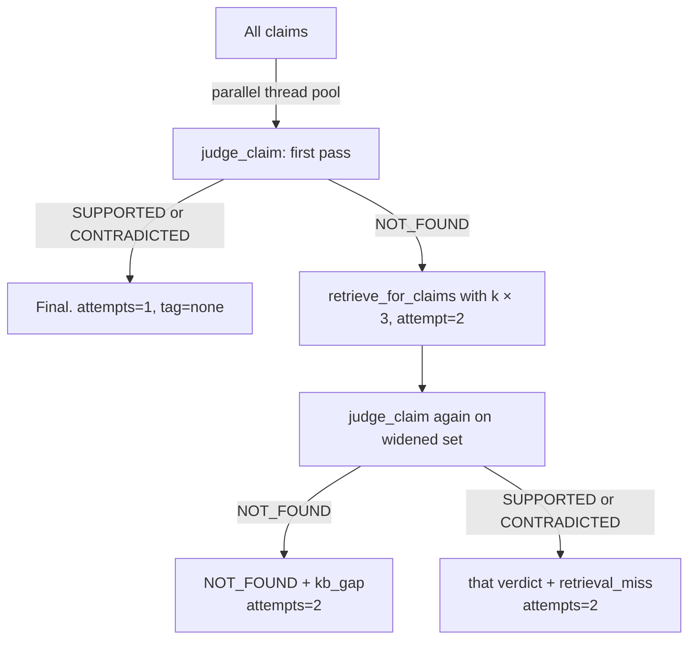

# Step 6 — Judge each claim

[← Step 5](s5-retrieve.md) · [Overview](../overview.md) · [Step 7 →](s7-aggregate.md)

**Runs inside:** `python -m ava_eval evaluate` · **Code:** [`ava_eval/steps/s6_judge.py`](../../ava_eval/steps/s6_judge.py) · **Prompt:** [`judge_claim.md`](../../ava_eval/llm/prompts/judge_claim.md)

## What it does

For each claim, a language model reads the retrieved excerpts, **and only those**, and answers with one of three
verdicts:

- `SUPPORTED`: an excerpt says it, or plainly implies it
- `CONTRADICTED`: an excerpt says something incompatible with it
- `NOT_FOUND`: the excerpts don't address it

It must also name the `chunk_id` that decided the verdict, so every flag can be traced back to exact KB wording.

A `NOT_FOUND` then gets **one retry with a wider search**, to tell "the KB doesn't cover this" apart from "our search
missed it".

## Inputs → outputs

| | |
|---|---|
| **Reads** | `Claim`s + step 5's results dict |
| **LLM returns** | [`JudgeResponse`](../../ava_eval/models.py): `verdict`, `rationale`, `evidence_chunk_id` |
| **Produces** | `JudgeBatch`: `verdicts` (list of [`ClaimVerdict`](../../ava_eval/models.py), which adds `tag` (`kb_gap` / `retrieval_miss` / none) and `attempts`) and `failures` (claim id → error, for claims that got no verdict) |
| **Writes** | `verdicts` via [`store.save_verdict`](../../ava_eval/db/store.py), plus `claim_retrievals` rows with `attempt=2` for retried claims |

## How the code works

[`judge_claims(conn, claims, retrievals)`](../../ava_eval/steps/s6_judge.py):

1. **First pass, in parallel:** `judge_claim` for every claim through a `ThreadPoolExecutor`.
2. Everything that isn't `NOT_FOUND` is final.
3. `NOT_FOUND` claims are searched again through [`retrieve_for_claims`](../../ava_eval/steps/s5_retrieve.py) with
   `k = AVA_TOP_K × AVA_RETRY_K_MULTIPLIER` and `attempt=2`.
4. Each one is judged again on the whole widened set (one claim after another), unconditionally. Still `NOT_FOUND` →
   `kb_gap`. Anything else → the evidence was there all along → `retrieval_miss`.
5. Save every verdict, and return the failures.

**When a claim can't be judged.** Every judge call is wrapped in `try/except LlmError` (only `LlmError`, so a real bug
still crashes):

| Where it failed | What happens |
|---|---|
| First pass | The claim goes into `failures` and gets **no verdict row**. The other claims are still saved. The report shows it as `UNJUDGED`, and `evaluate` prints it and exits 1 |
| Wider search (embedding) for the retry | Every retry claim keeps its first-pass `NOT_FOUND`, `attempts=1`, no tag, rationale ends `[retry failed: ...]` |
| Retry judge call | Same fallback, for that claim only |

The fallback is untagged on purpose: `kb_gap` vs `retrieval_miss` is decided *by* the retry, and it never ran.

[`render_excerpts`](../../ava_eval/steps/s6_judge.py) formats the chunks for the prompt. Each carries its
`chunk_id` (the judge has to name the chunk it used), its `source` (the chunk's `Group > Topic > Label` header, which
is how the judge knows which program an excerpt belongs to), and its similarity score.

Every verdict also stores the KB's content hash at judging time (`verdicts.kb_content_hash`), so step 7 can warn when
a verdict was judged against an older version of the knowledge base.

## Stub vs live

| `AVA_STUB_LLM=1` (default) | `AVA_STUB_LLM=0` |
|---|---|
| [`_judge_stub`](../../ava_eval/steps/s6_judge.py): finds the chunk sharing the most content words with the claim. Under 35% overlap → `NOT_FOUND`. Enough overlap but **no number in common** → `CONTRADICTED`. Otherwise `SUPPORTED`. | [`_judge_live`](../../ava_eval/steps/s6_judge.py): `load_prompt("judge_claim", subject_tag=..., claim_text=..., excerpts=render_excerpts(chunks))` → `generate_structured(prompt, JudgeResponse)` → [`_check_evidence`](../../ava_eval/steps/s6_judge.py) |

`AVA_STUB_LLM` is one switch for steps 3, 4 and 6 together.

The stub is crude, but it can produce all three verdicts, so the retry path and the rollup get exercised offline.
**The retry logic and tagging are real in both modes.**

## Why it's built this way

- **`CONTRADICTED` never retries.** A contradiction against a relevant chunk is final. Retrying would let the judge go
  looking for a friendlier chunk somewhere else in the KB, which is exactly how a real hallucination gets buried.
- **`NOT_FOUND` does retry**, because "KB gap" and "search miss" look identical at first but go to different people:
  TTU's content team versus whoever tunes this evaluator.
- **One pass with three possible answers, not two passes** (a gap check, then a contradiction check). Two passes would read the same
  evidence twice to answer one question in two halves, at double the cost.
- **Excerpts only, no outside knowledge.** A judge that uses what it "knows" about universities gives you a mix of
  "grounded in TTU docs" and "sounded plausible", and nobody can tell afterwards which verdicts were which. If you
  change one thing in the prompt, don't change this.
- **General policy counts.** A university-wide rule supports a program-specific claim, *unless* an excerpt shows a program
  override. Otherwise a KB that states a policy once, centrally (good documentation practice), would show up as full of gaps.
- **Temperature 0.** An evaluator that gives different verdicts on the same evidence isn't an evaluator.

## Gotchas

- **The evidence id is checked, and a bad one fails the claim.** If the model invents an id, the join in
  `v_claim_results` would find nothing and the flag would silently lose its evidence. So `_check_evidence` raises
  `LlmError` when the id isn't one of the chunks shown, or when a `SUPPORTED`/`CONTRADICTED` has no id at all. No
  re-ask: the claim becomes `UNJUDGED`. `NOT_FOUND` may cite nothing.
- **Bad JSON isn't retried.** `generate_structured` retries failed *calls*, not replies that don't match the schema, so
  those claims also end up `UNJUDGED`.
- **The retry pass runs one claim at a time**, unlike the threaded first pass. Slower with many `NOT_FOUND`s, gentler on quota.
- A `CONTRADICTED` found **on the retry** is tagged `retrieval_miss`. The tag says the *first search* missed; the
  verdict still says what the evidence shows.
- `tag` is only ever set on the retry path. A first-pass `SUPPORTED`/`CONTRADICTED` has `tag = NULL`.

## Tests

[`tests/test_judge_policy.py`](../../tests/test_judge_policy.py) scripts the judge's answers and checks:
`CONTRADICTED` and `SUPPORTED` never retry, `NOT_FOUND` → `kb_gap` when it's still not found, a rescue → `retrieval_miss`
(including a contradiction found on retry), the retry is saved as attempt 2, excerpts carry chunk ids, and prompt
loading (unknown field, unfilled placeholder, missing template). The live judge runs against a fake model: the prompt
carries the claim and every chunk id, a made-up or missing evidence id fails the claim and saves nothing, one failed
claim doesn't lose the others, and a failed retry (judge call or wider search) keeps the first-pass `NOT_FOUND`.

## Connects to

- **Previous:** [Step 5](s5-retrieve.md) supplied first-attempt chunks, and is called again for the retry.
- **Next:** [Step 7](s7-aggregate.md) reads `verdicts` through SQL views. Nothing is copied or summarised here.
- **Pipeline:** the counts and `failures` from `judge_claims` feed the `evaluate` command's per-session line
  ([`pipeline.py`](../../ava_eval/pipeline.py)), including `failed N`.
