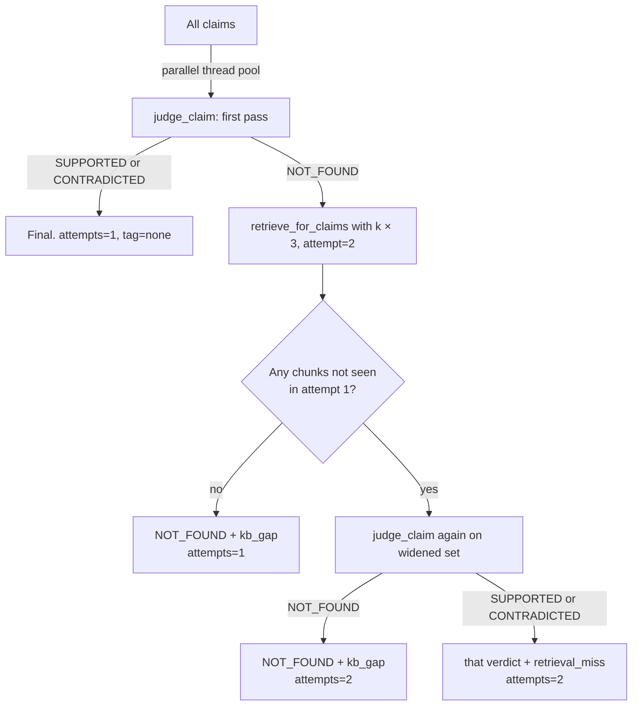

# Step 6 — Judge each claim

[← Step 5](s5-retrieve.md) · [Overview](../overview.md) · [Step 7 →](s7-aggregate.md)

**Runs inside:** `python -m ava_eval evaluate` · **Code:** [`ava_eval/steps/s6_judge.py`](../../ava_eval/steps/s6_judge.py) · **Prompt:** [`judge_claim.md`](../../ava_eval/llm/prompts/judge_claim.md)

## What it does

For each claim, a language model reads the retrieved excerpts, **and only those**, and answers with one of three
verdicts:

- `SUPPORTED`: an excerpt says it, or plainly implies it
- `CONTRADICTED`: an excerpt says something incompatible with it
- `NOT_FOUND`: the excerpts don't address it

It must also name the `chunk_id` that decided the verdict, so every flag can be traced back to exact KB wording.

A `NOT_FOUND` then gets **one retry with a wider search**, to tell "the KB doesn't cover this" apart from "our search
missed it".

## Inputs → outputs

| | |
|---|---|
| **Reads** | `Claim`s + step 5's results dict |
| **LLM returns** | [`JudgeResponse`](../../ava_eval/models.py#L223): `verdict`, `rationale`, `evidence_chunk_id` |
| **Produces** | [`ClaimVerdict`](../../ava_eval/models.py#L245): adds `tag` (`kb_gap` / `retrieval_miss` / none) and `attempts` |
| **Writes** | `verdicts` via [`store.save_verdict`](../../ava_eval/db/store.py#L560), plus `claim_retrievals` rows with `attempt=2` for retried claims |

## How the code works

[`judge_claims(conn, claims, retrievals)`](../../ava_eval/steps/s6_judge.py#L220):

1. **First pass, in parallel:** `judge_claim` for every claim through a `ThreadPoolExecutor`.
2. Everything that isn't `NOT_FOUND` is final.
3. `NOT_FOUND` claims are searched again through [`retrieve_for_claims`](../../ava_eval/steps/s5_retrieve.py#L56) with
   `k = AVA_TOP_K × AVA_RETRY_K_MULTIPLIER` and `attempt=2`.
4. For each one, compare with the first attempt ([line 268](../../ava_eval/steps/s6_judge.py#L268)):
   - **No new chunks** → the wider net caught nothing new, so the KB really doesn't have it → `kb_gap` without spending another judge call.
   - **New chunks** → judge again on the whole widened set (one claim after another). Still `NOT_FOUND` → `kb_gap`.
     Anything else → the evidence was there all along → `retrieval_miss`.
5. Save every verdict.

[`render_excerpts`](../../ava_eval/steps/s6_judge.py#L78) formats the chunks for the prompt. Each carries its
`chunk_id`, source, section and similarity score, because the judge has to name the chunk it used.

## Stub vs live

| `AVA_STUB_LLM=1` (default) | `AVA_STUB_LLM=0` |
|---|---|
| [`_judge_stub`](../../ava_eval/steps/s6_judge.py#L104): finds the chunk sharing the most content words with the claim. Under 35% overlap → `NOT_FOUND`. Enough overlap but **no number in common** → `CONTRADICTED`. Otherwise `SUPPORTED`. | [`_judge_live`](../../ava_eval/steps/s6_judge.py#L164) — **not implemented yet**. `load_prompt("judge_claim", subject_tag=..., claim_text=..., excerpts=render_excerpts(chunks))` → `generate_structured(prompt, JudgeResponse)` |

The stub is crude, but it can produce all three verdicts, so the retry path and the rollup get exercised offline.
**The retry logic and tagging are real in both modes.**

## Why it's built this way

- **`CONTRADICTED` never retries.** A contradiction against a relevant chunk is final. Retrying would let the judge go
  looking for a friendlier chunk somewhere else in the KB, which is exactly how a real hallucination gets buried.
- **`NOT_FOUND` does retry**, because "KB gap" and "search miss" look identical at first but go to different people:
  TTU's content team versus whoever tunes this evaluator.
- **One pass with three possible answers, not two passes** (a gap check, then a contradiction check). Two passes would read the same
  evidence twice to answer one question in two halves, at double the cost.
- **Excerpts only, no outside knowledge.** A judge that uses what it "knows" about universities gives you a mix of
  "grounded in TTU docs" and "sounded plausible", and nobody can tell afterwards which verdicts were which. If you
  change one thing in the prompt, don't change this.
- **General policy counts.** A university-wide rule supports a program-specific claim, *unless* an excerpt shows a program
  override. Otherwise a KB that states a policy once, centrally (good documentation practice), would show up as full of gaps.
- **Temperature 0.** An evaluator that gives different verdicts on the same evidence isn't an evaluator.

## Gotchas

- **Check `evidence_chunk_id` in the live version.** If the model invents an id, the join in `v_claim_results` finds
  nothing and the flag silently loses its evidence. Check the id is one of the chunks you passed in.
- A `CONTRADICTED` found **on the retry** is tagged `retrieval_miss`. The tag says the *first search* missed; the
  verdict still says what the evidence shows.
- `tag` is only ever set on the retry path. A first-pass `SUPPORTED`/`CONTRADICTED` has `tag = NULL`.

## Tests

[`tests/test_judge_policy.py`](../../tests/test_judge_policy.py) scripts the judge's answers and checks:
`CONTRADICTED` and `SUPPORTED` never retry, `NOT_FOUND` → `kb_gap` when it's still not found, a rescue → `retrieval_miss`
(including a contradiction found on retry), the retry is saved as attempt 2, excerpts carry chunk ids, and prompt
loading (unknown field, unfilled placeholder, missing template).

## Connects to

- **Previous:** [Step 5](s5-retrieve.md) supplied first-attempt chunks, and is called again for the retry.
- **Next:** [Step 7](s7-aggregate.md) reads `verdicts` through SQL views. Nothing is copied or summarised here.
- **Pipeline:** the counts in [`pipeline.py:122`](../../ava_eval/pipeline.py#L122) feed the `evaluate` command's per-session line.
